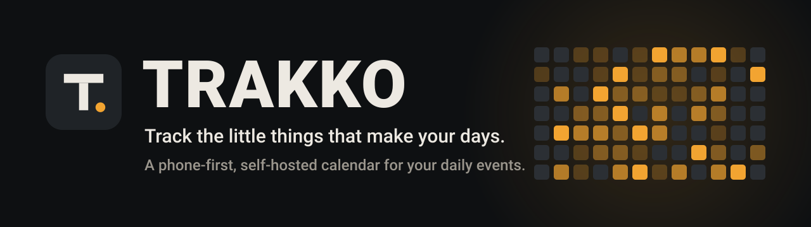
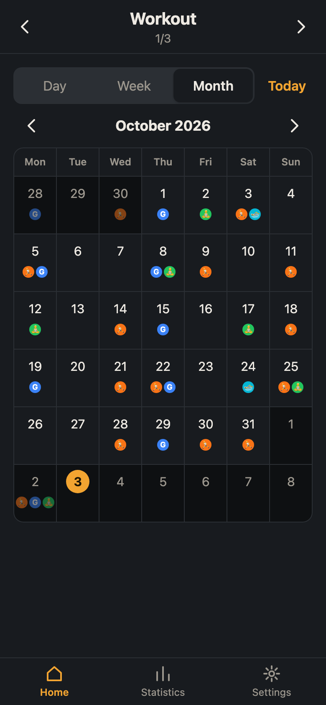
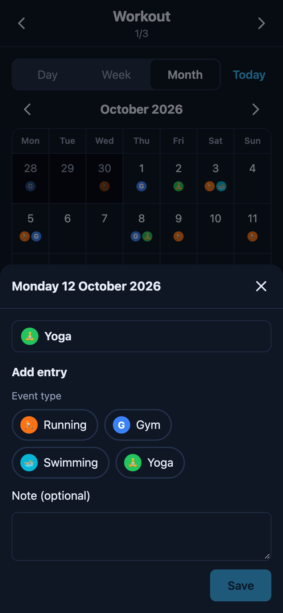
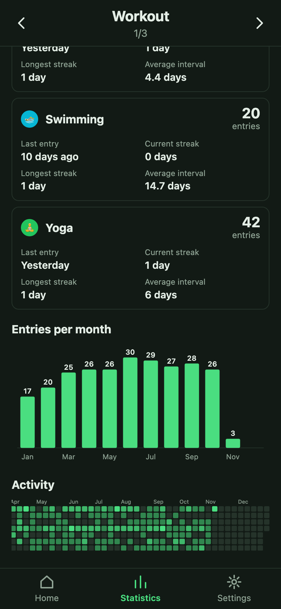
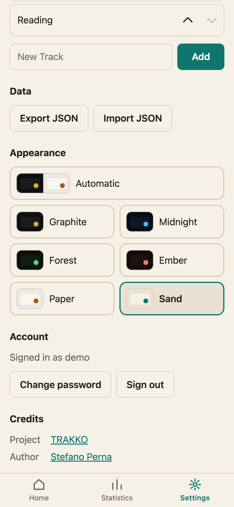

<p align="center">
  
</p>

<p align="center">
  <a href="https://github.com/pernastefano/trakko/actions/workflows/ci.yml"></a>
  <a href="https://github.com/pernastefano/trakko/actions/workflows/docker.yml"></a>
  
  
  <a href="LICENSE"></a>
</p>

<p align="center">
  <strong>Did you run today? When did your last cycle start? How long since the gym?</strong><br>
  TRAKKO is a tiny, self-hosted web app that answers questions like these.<br>
  Tap a day, tap what happened, done. Then watch the patterns appear.
</p>

<p align="center">
  
  
  
  
</p>
<p align="center"><sub>Real screenshots with demo data, in four of the seven themes.</sub></p>

## Contents

[Why TRAKKO](#why-trakko) · [How it works](#how-it-works) · [Features](#features) · [Quick start](#quick-start) · [Install it as an app](#install-it-as-an-app) · [Configuration](#configuration) · [Good to know](#good-to-know) · [Documentation](#documentation) · [Built with](#built-with) · [Contributing](#contributing)

## Why TRAKKO

- **Built for your thumb.** Designed for a phone first: logging an event is *tap a day → tap the event type → Save*, with an optional note. Nothing else gets in the way.
- **Yours, completely.** One SQLite file on your own server, a JSON export whenever you want it, and no analytics, trackers or third-party requests.
- **Shared, not mixed.** Several people can use one installation. Everybody has their own account and nobody sees anybody else's data.
- **Insight for free.** Counts, streaks, days since the last time, the average interval between two events (handy for cycles), bar charts and an activity heatmap, without doing anything extra.
- **Looks the way you like.** Seven themes, from graphite and amber to midnight blue, forest green, ember, paper and sand.
- **Simple to run, simple to change.** One container, or plain Python. The front end is vanilla JavaScript with no build step.

## How it works

You organize your life in **Tracks**. Each Track has its own **Event Types**, and every time something happens you add an **Entry** on a day, with an optional short note.

| Track | Event Types (examples) |
|-------|------------------------|
| Workout | 🏃 Running · **G** Gym · 🏊 Swimming · 🧘 Yoga |
| Cycle | 🩸 Cycle Start · ⭐ Ovulation · ✅ Cycle End |
| Reading | 📖 Finished a book |

Swipe the top bar to move between Tracks, switch the calendar between **Day**, **Week** and **Month**, and open **Statistics** whenever you are curious.

## Features

**Logging**
- Day, Week and Month calendar views; swipe or use the arrows to change period, "Today" to jump back.
- A bottom sheet per day: add, edit or delete entries, several per day if you like.
- Colored markers and icons on the calendar, so a glance tells you what happened when.

**Insights**
- Per Event Type: number of entries, last entry, current and longest streak, average interval.
- A bar chart of entries per week or month and a heatmap of your activity, for a month, a year or all time.

**Make it yours**
- Event Types with a name, a color (24 colors plus the background of every theme) and an icon: none, an emoji picked from a list, or one or two letters or digits.
- Reorder Tracks and Event Types, choose a default Track, and change the theme any time.

**Accounts and data**
- Sign up, sign in, sign out and change your password. Passwords are stored as salted `scrypt` hashes, and changing one signs out your other devices.
- Registration can be switched off once everyone has joined.
- Export everything as JSON and import it back, or move it to another account.

**Installable and fast**
- A Progressive Web App: add it to your home screen on iOS or Android and it opens full screen. The app shell works offline.
- A REST API under `/api/v1` with interactive OpenAPI docs at `/docs`.

## Quick start

### With Docker

The image is built by GitHub Actions and published to the GitHub Container Registry:

```bash
docker run -d --name trakko -p 8000:8000 -v trakko-data:/data \
  -e TRAKKO_SECRET_KEY='<a long random value>' \
  ghcr.io/pernastefano/trakko:latest
```

Open http://localhost:8000, tap **Create an account** and you are in. Keep `/data` on a volume, and put the container behind HTTPS before exposing it: see [docs/DEPLOYMENT.md](docs/DEPLOYMENT.md) for Compose, a reverse proxy, backups and upgrades.

### From source

Requires Python 3.12.

```bash
git clone https://github.com/pernastefano/trakko.git && cd trakko
python3.12 -m venv .venv && source .venv/bin/activate
pip install -r requirements.txt -r requirements-dev.txt
alembic upgrade head            # create the SQLite database
uvicorn app.main:app --reload
```

The app runs at http://localhost:8000 and `GET /health` returns `{"status": "ok"}`.

## Install it as an app

Open your TRAKKO address (it must be `https://`, except on `localhost`) and add it to the home screen:

- **iPhone / iPad:** in Safari, tap **Share → Add to Home Screen**.
- **Android:** in Chrome, tap **⋮ → Install app**.

More in the [user guide](docs/USER_GUIDE.md).

## Configuration

All configuration is done through environment variables (`.env.example` lists them; the app does not read `.env` files itself).

| Variable | Default | Description |
|----------|---------|-------------|
| `TRAKKO_DB_PATH` | `data/trakko.db` (`/data/trakko.db` in the image) | Path of the SQLite database file. |
| `TRAKKO_SECRET_KEY` | _(random at every start)_ | Secret used to sign session cookies. Set it in production; without it a random key is generated and everyone is signed out whenever the app restarts. |
| `TRAKKO_ALLOW_REGISTRATION` | `true` | Whether new accounts can be created. Set to `false` once everyone has registered (it stays possible while no account exists). |

## Good to know

- **No email, so no password recovery.** You can change your password while signed in; if you forget it, create a new account and import your JSON export.
- **Registration is open by default.** Anyone who can reach the address can create an account, so close registration when your people are in. The app does not limit sign-in attempts: rate-limit them in your reverse proxy.
- **Offline is read-only.** The app opens without a connection and shows what it last loaded, but changes need the server.
- **Upgrading from a version without accounts deletes its data** (nothing owned it); export it first. Details in the [deployment guide](docs/DEPLOYMENT.md#upgrading).

## Documentation

| Document | Contents |
|----------|----------|
| [docs/USER_GUIDE.md](docs/USER_GUIDE.md) | Install on iOS/Android, Tracks, logging, calendar, statistics, themes, export/import. |
| [docs/DEPLOYMENT.md](docs/DEPLOYMENT.md) | Container, volume, environment variables, HTTPS and reverse proxy, backups. |
| [docs/API.md](docs/API.md) | REST endpoints with examples (full reference at `/docs`). |
| [docs/ARCHITECTURE.md](docs/ARCHITECTURE.md) | Components, data model, request flow, service worker, design decisions. |
| [docs/DEVELOPMENT.md](docs/DEVELOPMENT.md) | Setup, commands, tests and conventions. |
| [CONTRIBUTING.md](CONTRIBUTING.md) | Branches, commits, pull requests. |
| [CHANGELOG.md](CHANGELOG.md) | Notable changes. |

## Built with

Python 3.12 · FastAPI · SQLAlchemy 2 · Alembic · Pydantic v2 · Jinja2 · SQLite · vanilla JavaScript (ES modules, no build step) · plain CSS · inline SVG charts · a service worker for the PWA.

## Contributing

Contributions are welcome. TRAKKO stays small on purpose: *when in doubt, remove UI rather than add it*. Read [CONTRIBUTING.md](CONTRIBUTING.md), then:

```bash
ruff format . && ruff check .   # format + lint
pytest                          # run the tests
```

See [docs/DEVELOPMENT.md](docs/DEVELOPMENT.md) for the rest.

## License

MIT, see [LICENSE](LICENSE). Created by [Stefano Perna](https://github.com/pernastefano).
