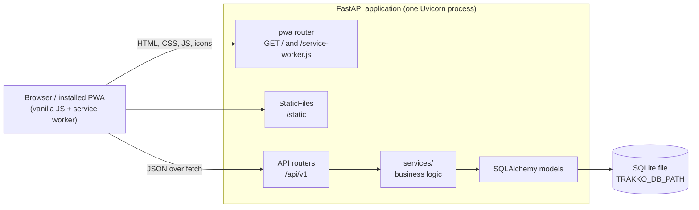
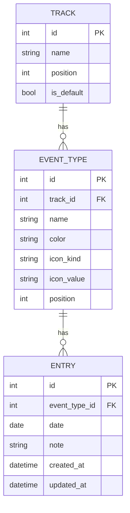
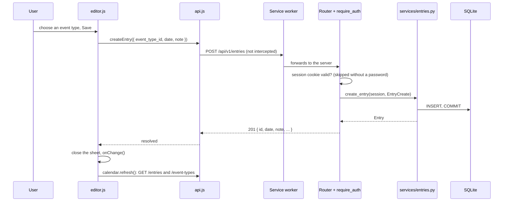

# Architecture

TRAKKO is a single-user, mobile-first PWA. A FastAPI application serves one HTML page, its static
assets and a JSON API; the browser side is plain JavaScript (ES modules) with no build step. Data
lives in one SQLite file.

## Components

| Layer | Where | Responsibility |
|-------|-------|----------------|
| Entry point | `app/main.py` | Builds the app, registers routers, error handlers and `/static`, serves `/health`. |
| Settings | `app/config.py` | Reads `TRAKKO_DB_PATH`, `TRAKKO_PASSWORD`, `TRAKKO_SECRET_KEY` from the environment. |
| Database | `app/db.py`, `app/models.py`, `alembic/` | Engine (foreign keys on), declarative models, migrations. |
| Schemas | `app/schemas.py` | Pydantic v2 models: validation of colors, dates, notes, icons, export documents. |
| Routers | `app/routers/` | Thin HTTP layer: parse the request, call a service, shape the response. |
| Services | `app/services/` | All business rules (default Track, ordering, statistics, import/export, auth tokens, PWA assets). |
| Errors | `app/errors.py` | Domain exceptions (`NotFoundError`, `ConflictError`, `InvalidError`, `UnauthorizedError`) mapped to `{ "detail": "..." }`. |
| Front end | `app/templates/`, `app/static/` | One Jinja2 page plus ES modules, CSS and the service worker. |

## Data model

- **Cascades.** Deleting a Track deletes its Event Types and their Entries; deleting an Event Type
  deletes its Entries. This is enforced by `ON DELETE CASCADE` foreign keys (SQLite's
  `PRAGMA foreign_keys=ON` is switched on for every connection in `app/db.py`) and mirrored by the
  ORM relationships.
- **One default Track.** A partial unique index (`is_default = 1`) allows at most one default; the
  service layer guarantees there is always exactly one (the first Track created becomes the default,
  deleting the default promotes the first remaining Track, the only Track cannot be deleted).
- **Database-level checks.** `icon_kind IN ('none', 'emoji', 'text')` and `length(note) <= 280`.
- **Dates are plain calendar dates** (`DATE` column, `YYYY-MM-DD` strings in JSON and JavaScript).
  They are never converted through time zones. Only `created_at` and `updated_at` are timestamps,
  stored as naive UTC and sent as ISO 8601 with a `Z` suffix.
- **Positions.** Tracks and Event Types are ordered by `position`; reordering rewrites positions
  `0..n-1` from a complete list of ids.
- The initial migration seeds one Track ("My Track", default) so a fresh install is usable.

## Request flow

Adding an entry from the day editor:

Request handling in more detail:

1. `require_auth` (a router-level dependency on every `/api/v1` router except `/auth`) lets the
   request through when no password is configured, otherwise it checks the signed session cookie.
2. FastAPI validates the body with the Pydantic schema. Validation errors are rewritten to a single
   `{ "detail": "field: message" }` string.
3. The router calls a function in `app/services/`, passing the SQLAlchemy `Session` from the
   `get_session` dependency. Services commit and raise domain errors, which `main.py` turns into
   404, 409, 422 or 401 responses.
4. The response model serializes the ORM object.

## Front end

There is a single page (`index.html`) with three screens (Home, Statistics, Settings) switched by
the URL hash, and three dialogs (day editor, event type editor, confirmation). JavaScript is split
into ES modules with no globals; modules communicate through function calls and a few window
events.

| Module | Role |
|--------|------|
| `main.js` | Boot: authentication, loading Tracks, wiring the other modules together. |
| `api.js` | The only place that calls `fetch`; error type `ApiError`; connectivity reporting. |
| `auth.js` | Sign-in form when the server requires a password. |
| `tracks.js`, `swipe.js` | Track selector (arrows, swipe, "2/5"). |
| `calendar.js`, `dates.js`, `markers.js` | Day/Week/Month views, date arithmetic on `YYYY-MM-DD` strings, entry markers. |
| `editor.js` | Bottom sheet to add, edit and delete the entries of a day. |
| `settings.js`, `type-editor.js`, `confirm.js`, `data-transfer.js` | Settings screens, Event Type dialog, confirmations, JSON export/import. |
| `stats.js`, `charts.js` | Statistics screen; SVG bar chart and heatmap. |
| `views.js`, `offline.js`, `pwa.js`, `dom.js` | Hash routing, offline banner, service worker registration, DOM helpers. |

Window events used between modules:

| Event | Sent by | Meaning |
|-------|---------|---------|
| `trakko:day-tap` | `calendar.js` | A day was tapped (`detail.date`); the day editor opens. |
| `trakko:data-changed` | `settings.js` | Tracks or Event Types changed; `main.js` reloads the Tracks. |
| `trakko:connectivity` | `api.js` | The server became reachable or unreachable; drives the offline banner. |

Text is always inserted with `textContent` (never HTML), there are no inline scripts, and colors
and sizes come from CSS custom properties with a `prefers-color-scheme: dark` override.

## Authentication

Authentication is optional and single-user. With `TRAKKO_PASSWORD` set:

- `POST /api/v1/auth/login` compares the password in constant time and sets the `trakko_session`
  cookie: `HttpOnly`, `SameSite=Lax`, 30 days, `Secure` when the request arrived over HTTPS.
- The cookie value is `<expiry>.<HMAC-SHA256(expiry, TRAKKO_SECRET_KEY)>`, built with the standard
  library only (no extra dependency). Changing the secret key signs everyone out.
- The app refuses to start if a password is set without a secret key.

Without a password nothing is protected; run it that way only on a trusted network.

## PWA and service worker

`/service-worker.js` is served by a dedicated route (so its scope is `/`) with `Cache-Control:
no-cache`. The server renders the file on each request, substituting two placeholders:

- the **asset version**: a hash of every file in `app/static/` and `app/templates/`;
- the **precache list**: `/` plus every file under `/static/`.

Any change to the shell therefore changes the service worker's bytes, which makes the browser
install the new version, precache fresh copies and delete the old cache on activation.

| Request | Strategy |
|---------|----------|
| `/static/*` | Cache first from the versioned `trakko-static-<hash>` cache (precached on install). |
| `GET /` (navigation) | Network first; falls back to the cached shell when offline. |
| `GET /api/*` | Network first. Successful responses are copied to `trakko-api-v1`; offline, the copy is returned with an `X-Trakko-Offline` header, or a `503 { "detail": "You are offline." }` if there is none. |
| `/api/v1/auth/*`, `/api/v1/export` | Never stored. |
| Everything except `GET` | Not intercepted: writes need the network. |

`api.js` turns the 503 or the `X-Trakko-Offline` header into the offline banner. Signing out
deletes the API cache so a signed-out device keeps no data. Offline writes are out of scope for v1.

## Key design decisions

- **No front-end build step.** ES modules and plain CSS are served as they are; the stack stays
  small and a checkout runs immediately. The cost is no bundler-level checks, which is why
  `tests/test_static_js.py` verifies imports, element ids and cross-file contracts.
- **Business logic in services.** Routers stay thin so rules (default Track, cascade counts,
  ordering, statistics) are tested without HTTP and reused by export/import.
- **SQLite with Alembic.** One file is enough for a single user; migrations use batch mode so
  schema changes work on SQLite.
- **Dates as strings, not timestamps.** A day is a day for the user wherever they are, so entries
  carry a calendar date and the server never applies a time zone. The browser supplies "today".
- **Weeks start on Monday**, in both the calendar and the statistics buckets.
- **Statistics take two dates.** `ref` selects the month/year to show, `today` is the current day
  for streaks and "days since"; this keeps past periods consistent.
- **Import replaces everything** in one transaction after validating the whole document, so a bad
  file cannot leave a half-imported database.
- **Destructive actions are confirmed** in the UI with the number of items that will disappear;
  deleting an entry needs two steps (open it, then Delete).
- **Minimal UI.** Few controls, big touch targets (44 px), no animations beyond a short sheet
  transition that respects `prefers-reduced-motion`.
