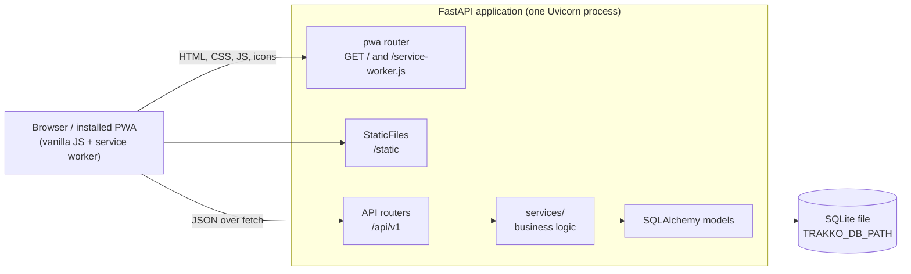
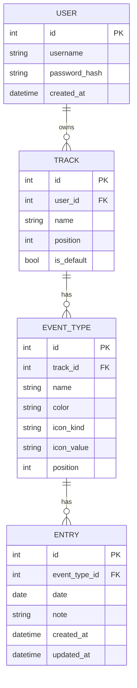
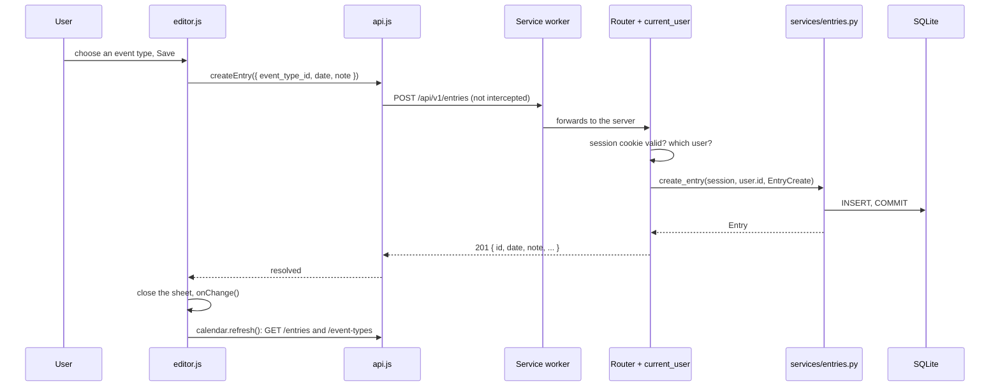

# Architecture

TRAKKO is a mobile-first PWA that several people can share, each with their own account and data. A FastAPI application serves one HTML page, its static
assets and a JSON API; the browser side is plain JavaScript (ES modules) with no build step. Data
lives in one SQLite file.

## Components

| Layer | Where | Responsibility |
|-------|-------|----------------|
| Entry point | `app/main.py` | Builds the app, registers routers, error handlers and `/static`, serves `/health`. |
| Settings | `app/config.py` | Reads `TRAKKO_DB_PATH`, `TRAKKO_SECRET_KEY` and `TRAKKO_ALLOW_REGISTRATION` from the environment. |
| Database | `app/db.py`, `app/models.py`, `alembic/` | Engine (foreign keys on), declarative models, migrations. |
| Schemas | `app/schemas.py` | Pydantic v2 models: validation of colors, dates, notes, icons, export documents. |
| Routers | `app/routers/` | Thin HTTP layer: parse the request, call a service, shape the response. |
| Services | `app/services/` | All business rules (accounts and passwords, session tokens, per-user data access, default Track, ordering, statistics, import/export, PWA assets). |
| Errors | `app/errors.py` | Domain exceptions (`NotFoundError`, `ConflictError`, `InvalidError`, `UnauthorizedError`) mapped to `{ "detail": "..." }`. |
| Front end | `app/templates/`, `app/static/` | One Jinja2 page plus ES modules, CSS and the service worker. |

## Data model

- **Ownership.** Every Track belongs to exactly one user; Event Types and Entries belong to a user
  through their Track. Every query in `app/services/` takes the signed-in user's id and filters on
  it, and a resource of another user is reported as "not found".
- **Cascades.** Deleting a user deletes their Tracks; deleting a Track deletes its Event Types and
  their Entries; deleting an Event Type deletes its Entries. This is enforced by `ON DELETE CASCADE` foreign keys (SQLite's
  `PRAGMA foreign_keys=ON` is switched on for every connection in `app/db.py`) and mirrored by the
  ORM relationships.
- **One default Track per user.** A partial unique index on `user_id` (`is_default = 1`) allows at
  most one default each; the service layer guarantees there is always exactly one (the first Track
  created becomes the default, deleting the default promotes the user's first remaining Track, the
  only Track cannot be deleted).
- **Database-level checks.** `icon_kind IN ('none', 'emoji', 'text')` and `length(note) <= 280`.
- **Dates are plain calendar dates** (`DATE` column, `YYYY-MM-DD` strings in JSON and JavaScript).
  They are never converted through time zones. Only `created_at` and `updated_at` are timestamps,
  stored as naive UTC and sent as ISO 8601 with a `Z` suffix.
- **Positions.** Tracks and Event Types are ordered by `position`; reordering rewrites positions
  `0..n-1` from a complete list of ids.
- Registering an account creates its first Track ("My Track", default), so a new user can start
  logging straight away. Migration `0002` introduced accounts and deleted all data created before
  them, because that data had no owner.

## Request flow

Adding an entry from the day editor:

Request handling in more detail:

1. `current_user` (a router-level dependency on every `/api/v1` router except `/auth`) verifies the
   signed session cookie, loads the user it names and answers 401 otherwise. Endpoints receive the
   user and pass `user.id` to the services.
2. FastAPI validates the body with the Pydantic schema. Validation errors are rewritten to a single
   `{ "detail": "field: message" }` string.
3. The router calls a function in `app/services/`, passing the SQLAlchemy `Session` from the
   `get_session` dependency. Services commit and raise domain errors, which `main.py` turns into
   404, 409, 422 or 401 responses.
4. The response model serializes the ORM object.

## Front end

There is a single page (`index.html`) with three screens (Home, Statistics, Settings) switched by
the URL hash, and three dialogs (day editor, event type editor, confirmation). JavaScript is split
into ES modules with no globals; modules communicate through function calls and a few window
events.

| Module | Role |
|--------|------|
| `main.js` | Boot: authentication, loading Tracks, wiring the other modules together. |
| `api.js` | The only place that calls `fetch`; error type `ApiError`; connectivity reporting. |
| `auth.js` | Sign-in and account-creation form, shown when nobody is signed in. |
| `tracks.js`, `swipe.js` | Track selector (arrows, swipe, "2/5"). |
| `calendar.js`, `dates.js`, `markers.js` | Day/Week/Month views, date arithmetic on `YYYY-MM-DD` strings, entry markers. |
| `editor.js` | Bottom sheet to add, edit and delete the entries of a day. |
| `settings.js`, `type-editor.js`, `confirm.js`, `data-transfer.js` | Settings screens, Event Type dialog, confirmations, JSON export/import. |
| `emoji-picker.js`, `emoji-data.js` | Emoji chosen from a list (a bottom sheet) instead of typed; only emoji the device can draw are shown. |
| `stats.js`, `charts.js` | Statistics screen; SVG bar chart and heatmap. |
| `views.js`, `offline.js`, `pwa.js`, `dom.js` | Hash routing, offline banner, service worker registration, DOM helpers. |

Window events used between modules:

| Event | Sent by | Meaning |
|-------|---------|---------|
| `trakko:day-tap` | `calendar.js` | A day was tapped (`detail.date`); the day editor opens. |
| `trakko:data-changed` | `settings.js` | Tracks or Event Types changed; `main.js` reloads the Tracks. |
| `trakko:connectivity` | `api.js` | The server became reachable or unreachable; drives the offline banner. |

Text is always inserted with `textContent` (never HTML), there are no inline scripts, and colors
and sizes come from CSS custom properties with a `prefers-color-scheme: dark` override.

## Accounts and authentication

Accounts are a username and a password; there is no email address, so there is no password
recovery. Several users coexist in one database and never see each other's data.

- `POST /api/v1/auth/register` creates the account (and its first Track) and signs in;
  `POST /api/v1/auth/login` signs in; `POST /api/v1/auth/logout` signs out.
- **Passwords** are stored as salted `scrypt` hashes (`hashlib.scrypt`, no extra dependency); the
  parameters are stored with each hash so the cost can be raised later. Logging in with an unknown
  name costs the same time as a wrong password, and both give the same message.
- **Session cookie** `trakko_session`: `HttpOnly`, `SameSite=Lax`, 30 days, `Secure` when the request
  arrived over HTTPS. Its value is `<user id>.<expiry>.<HMAC-SHA256>`, signed with
  `TRAKKO_SECRET_KEY` using the standard library only. Changing the key signs everyone out; a
  cookie for a deleted user stops working.
- **Registration** can be closed with `TRAKKO_ALLOW_REGISTRATION=false`, but it stays possible while
  no account exists, so a new installation can always create its first user.
- Without `TRAKKO_SECRET_KEY` a random key is generated at startup (with a warning): everything works
  but sessions end when the process restarts.
- There is no limit on sign-in attempts in the application; rate-limit `POST /api/v1/auth/login` and
  `/register` in the reverse proxy (see the deployment guide).

## PWA and service worker

`/service-worker.js` is served by a dedicated route (so its scope is `/`) with `Cache-Control:
no-cache`. The server renders the file on each request, substituting two placeholders:

- the **asset version**: a hash of every file in `app/static/` and `app/templates/`;
- the **precache list**: `/` plus every file under `/static/`.

Any change to the shell therefore changes the service worker's bytes, which makes the browser
install the new version, precache fresh copies and delete the old cache on activation.

| Request | Strategy |
|---------|----------|
| `/static/*` | Cache first from the versioned `trakko-static-<hash>` cache (precached on install). |
| `GET /` (navigation) | Network first; falls back to the cached shell when offline. |
| `GET /api/*` | Network first. Successful responses are copied to `trakko-api-v1`; offline, the copy is returned with an `X-Trakko-Offline` header, or a `503 { "detail": "You are offline." }` if there is none. |
| `/api/v1/auth/*`, `/api/v1/export` | Never stored. |
| Everything except `GET` | Not intercepted: writes need the network. |

`api.js` turns the 503 or the `X-Trakko-Offline` header into the offline banner. Signing out
and signing in both delete the API cache, so a device never shows one account's cached data to the
next one. Offline writes are out of scope for v1.

## Key design decisions

- **No front-end build step.** ES modules and plain CSS are served as they are; the stack stays
  small and a checkout runs immediately. The cost is no bundler-level checks, which is why
  `tests/test_static_js.py` verifies imports, element ids and cross-file contracts.
- **Business logic in services.** Routers stay thin so rules (default Track, cascade counts,
  ordering, statistics) are tested without HTTP and reused by export/import.
- **SQLite with Alembic.** One file is enough for a single user; migrations use batch mode so
  schema changes work on SQLite.
- **Dates as strings, not timestamps.** A day is a day for the user wherever they are, so entries
  carry a calendar date and the server never applies a time zone. The browser supplies "today".
- **Weeks start on Monday**, in both the calendar and the statistics buckets.
- **Statistics take two dates.** `ref` selects the month/year to show, `today` is the current day
  for streaks and "days since"; this keeps past periods consistent.
- **Import replaces everything** in one transaction after validating the whole document, so a bad
  file cannot leave a half-imported database.
- **Destructive actions are confirmed** in the UI with the number of items that will disappear;
  deleting an entry needs two steps (open it, then Delete).
- **Minimal UI.** Few controls, big touch targets (44 px), no animations beyond a short sheet
  transition that respects `prefers-reduced-motion`.
